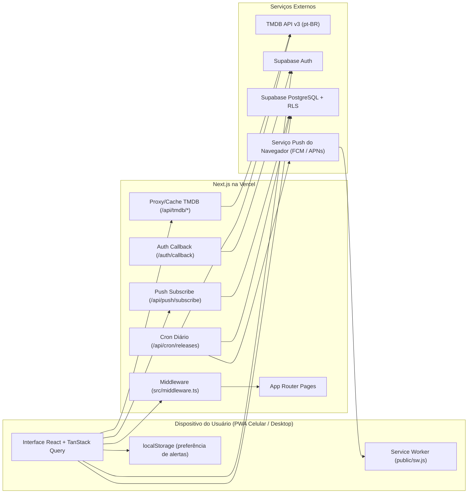
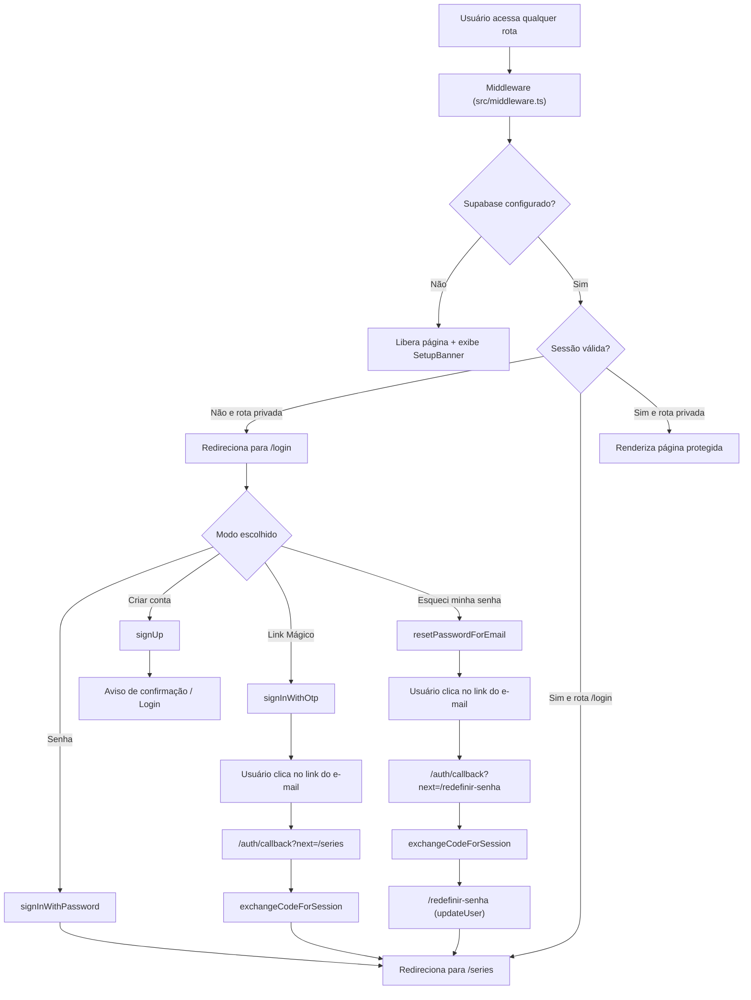
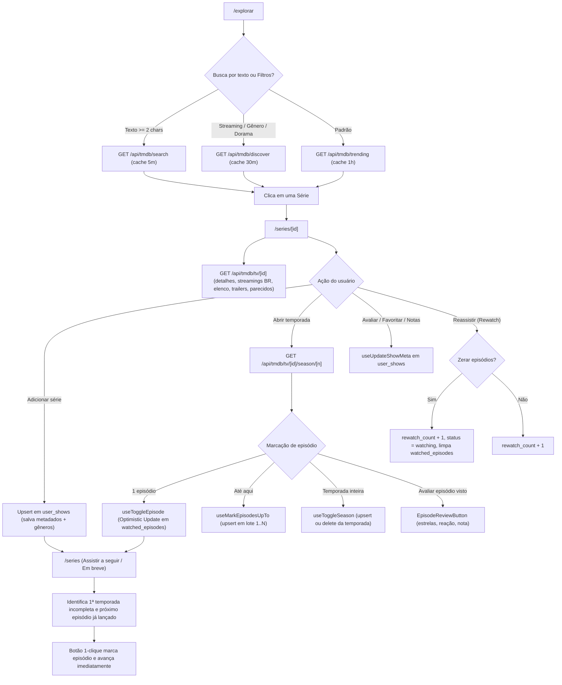
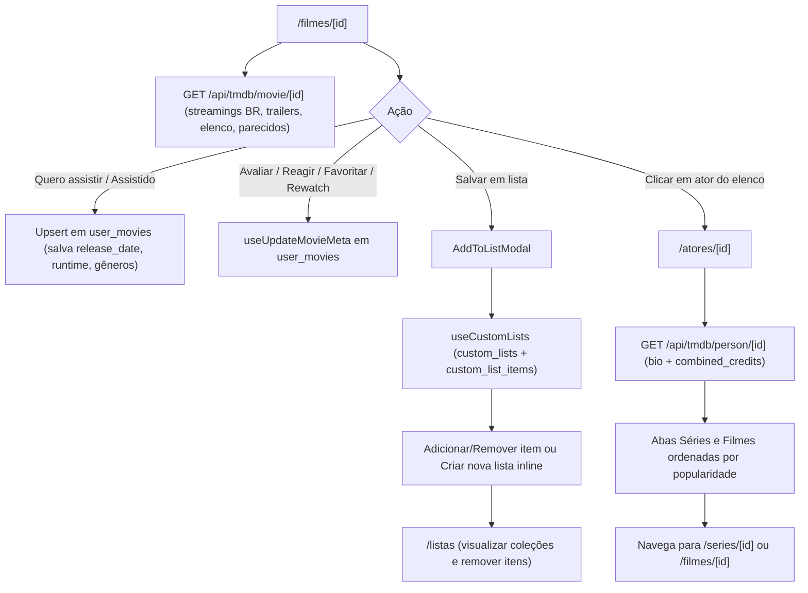
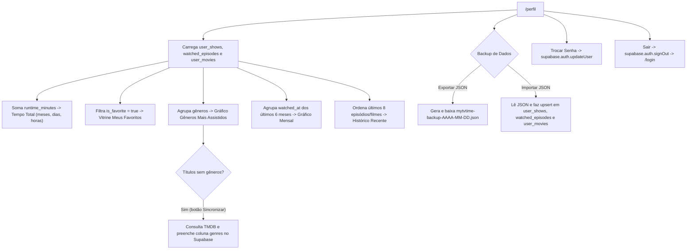
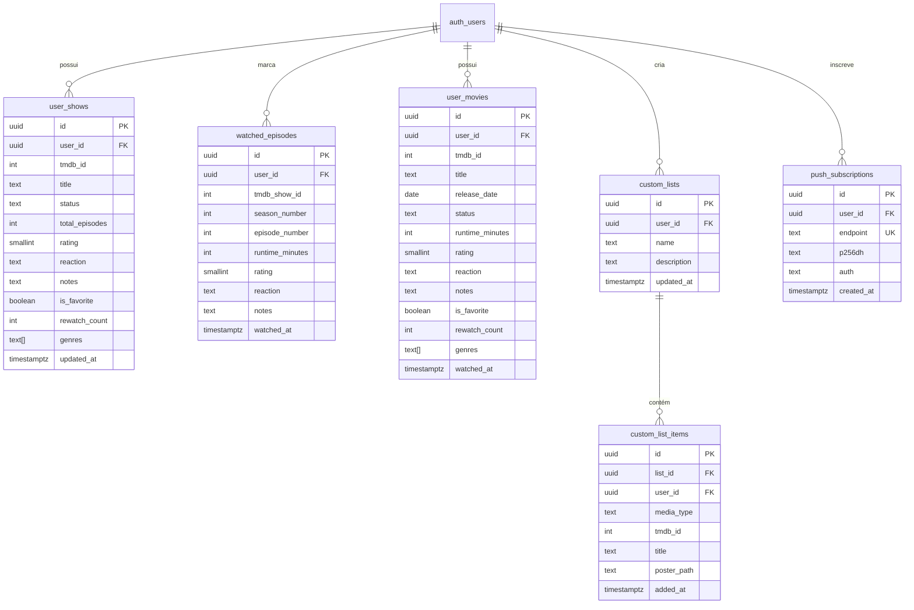

# Documentação Técnica & Fluxogramas — MyTVTime

Esta documentação descreve em detalhes a arquitetura, o mapa de código, as rotas de API, o banco de dados, a estratégia de cache e todos os fluxos de funcionamento do **MyTVTime**.

---

## 1. Visão Geral e Stack Tecnológica

O **MyTVTime** é um aplicativo Web responsivo e **PWA (Progressive Web App)** voltado para o acompanhamento pessoal de séries, doramas e filmes, com foco em saber exatamente qual é o próximo episódio a assistir e quando os próximos lançamentos acontecem.

| Camada | Tecnologia | Função no Projeto |
| :--- | :--- | :--- |
| **Framework Fullstack** | Next.js 15 (App Router) + React 19 + TypeScript | Renderização de páginas, rotas de API (proxy/cache TMDB, Web Push, Cron) e Middleware de autenticação. |
| **Estilização & Ícones** | Tailwind CSS v4 + Lucide React | Design Dark Mode (`#0E0F12` / `#16181D` + destaque `#F5C518`), layout responsivo mobile-first e desktop. |
| **Estado & Cache Cliente** | TanStack Query v5 | Cache em memória no cliente, invalidação automática e *Optimistic Updates* ao marcar episódios. |
| **Banco de Dados & Auth** | Supabase (PostgreSQL + Auth + RLS) | Persistência na nuvem sincronizada entre dispositivos, autenticação (Senha, Link Mágico, Recuperação) e isolamento por usuário via RLS. |
| **Catálogo & Metadados** | TMDB API v3 | Busca, tendências, filtros por streaming/gênero/dorama, temporadas, episódios, elenco, trailers e datas de estreia em `pt-BR`. |
| **PWA & Push** | Web App Manifest + Service Worker + `web-push` | Instalação na tela inicial (Android/iOS), ícone nativo e notificações Push em segundo plano via VAPID. |
| **Hospedagem & Agendamento** | Vercel + Vercel Cron (`vercel.json`) | Deploy contínuo via Git, HTTPS nativo e rotina diária às 09h BRT (`0 12 * * *`). |

---

## 2. Arquitetura Geral do Sistema



---

## 3. Estrutura de Diretórios e Arquivos

```text
c:\Projetos\TVTime\
├── public/
│   ├── manifest.json              # Manifesto PWA (nome, cores, display standalone, ícones)
│   ├── sw.js                      # Service Worker (network-first, push e notificationclick)
│   ├── icon.svg                   # Ícone vetorial
│   ├── icon-192.png               # Ícone PWA 192x192
│   ├── icon-512.png               # Ícone PWA 512x512
│   └── apple-touch-icon.png       # Ícone iOS 180x180
├── supabase/
│   ├── schema.sql                 # Script consolidado completo (instalação do zero)
│   ├── migration_v2_lists.sql     # Migração incremental: listas personalizadas
│   └── migration_v3_fase3.sql     # Migração incremental: avaliações, favoritos, rewatch, gêneros e push
├── docs/
│   └── ARQUITETURA_E_FLUXOS.md    # Esta documentação
├── vercel.json                    # Configuração do Cron diário (/api/cron/releases)
├── .env.example                   # Modelo de variáveis de ambiente
└── src/
    ├── middleware.ts              # Refresh de sessão Supabase e proteção de rotas
    ├── types/index.ts             # Tipagens TypeScript (Supabase + TMDB)
    ├── lib/
    │   ├── env.ts                 # Checagem de configuração do ambiente
    │   ├── cache.ts               # Parametrização centralizada de cache via .env (com defaults)
    │   ├── tmdb.ts                # Cliente fetch server-side com cache (revalidate) e URLs de imagem
    │   ├── dates.ts               # Formatação pt-BR, T01E01, contagem regressiva e tempo assistido
    │   ├── supabase/
    │   │   ├── client.ts          # Cliente Supabase para Browser Components
    │   │   └── server.ts          # Cliente Supabase SSR (cookies) para Route Handlers
    │   └── queries/
    │       └── useLibrary.ts      # Todos os hooks TanStack Query + mutations + optimistic updates
    ├── components/
    │   ├── Providers.tsx          # QueryClientProvider + registro do Service Worker
    │   ├── AppShell.tsx           # Shell responsivo (Sidebar Desktop + Bottom Bar Mobile)
    │   ├── SetupBanner.tsx        # Alerta amigável caso .env.local não esteja preenchido
    │   ├── MediaCard.tsx          # Card reutilizável de pôster (Série ou Filme)
    │   ├── MediaExtras.tsx        # Trailer modal (YouTube), Elenco clicável e Títulos Parecidos
    │   ├── AddToListModal.tsx     # Modal para salvar/remover item em listas personalizadas
    │   ├── ReviewControls.tsx     # Estrelas, Reações, Notas, Favorito, Rewatch e avaliação por episódio
    │   └── ReleaseNotifications.tsx # Sino de alertas (próximos 3 dias) + notificação local no dia
    └── app/
        ├── page.tsx               # Redireciona para /series
        ├── login/page.tsx         # Login (Senha, Link Mágico, Criar conta, Esqueci minha senha)
        ├── redefinir-senha/page.tsx # Tela de definição de nova senha pós-e-mail
        ├── auth/callback/route.ts # Troca de código PKCE por sessão (Magic Link / Reset)
        ├── series/page.tsx        # Home: Assistir a seguir (Up Next), Em breve e Minhas Séries
        ├── series/[id]/page.tsx   # Detalhes da série, streamings BR, temporadas, episódios, avaliação
        ├── filmes/page.tsx        # Filmes: Quero assistir, Em breve e Assistidos
        ├── filmes/[id]/page.tsx   # Detalhes do filme, streamings BR, trailer, elenco, avaliação
        ├── calendario/page.tsx    # Calendário Visual Mensal e Semanal (séries + filmes)
        ├── listas/page.tsx        # Gerenciamento de listas personalizadas
        ├── explorar/page.tsx      # Busca + Filtros (Streaming BR, Gênero, Doramas) + Destaques
        ├── atores/[id]/page.tsx   # Perfil do ator (bio + filmografia de séries e filmes)
        ├── perfil/page.tsx        # Estatísticas, Favoritos, Gêneros, Gráfico, Backup JSON, Push e Senha
        └── api/
            ├── status/route.ts
            ├── push/subscribe/route.ts
            ├── cron/releases/route.ts
            └── tmdb/
                ├── search/route.ts
                ├── trending/route.ts
                ├── discover/route.ts
                ├── tv/[id]/route.ts
                ├── tv/[id]/season/[seasonNumber]/route.ts
                ├── movie/[id]/route.ts
                └── person/[id]/route.ts
```

---

## 4. Fluxogramas Completos da Aplicação

### 4.1 Fluxo de Autenticação, Middleware e Sessão



---

### 4.2 Fluxo Principal de Séries (Explorar → Detalhes → Up Next → Rewatch)



---

### 4.3 Fluxo de Filmes, Listas Personalizadas e Perfil de Atores



---

### 4.4 Fluxo do Calendário Visual e Notificações (Locais + Web Push)

```mermaid
flowchart TD
    subgraph Calendar["Calendário Visual (/calendario)"]
        CalStart["Carrega user_shows ativos + user_movies"] --> CalFetch["Busca última temporada no TMDB + next_episode_to_air"]
        CalFetch --> CalMerge["Unifica episódios e estreias por data YYYY-MM-DD"]
        CalMerge --> CalView{"Visão selecionada"}
        CalView -- "Mensal" --> MonthGrid["Grade mensal com marcadores amarelo (Série) e azul (Filme)"]
        CalView -- "Semanal" --> WeekList["Lista dos 7 dias da semana com destaque para HOJE"]
    end

    subgraph LocalNotif["Alertas no App (ReleaseNotifications)"]
        Bell["Sino no Header/Sidebar"] --> Next3["Filtra estreias em 0..3 dias"]
        Next3 --> Badge["Exibe contador + dropdown com links diretos"]
        Next3 --> LocalCheck{"Hoje + permissão concedida?"}
        LocalCheck -- "Sim e não enviado hoje" --> BrowserNotif["Dispara Notification nativa + registra ID no localStorage"]
    end

    subgraph BgPush["Web Push em Segundo Plano (App Fechado)"]
        EnablePush["Usuário ativa Alertas no /perfil"] --> SubSW["Service Worker pushManager.subscribe (VAPID Public Key)"]
        SubSW --> SaveSub["POST /api/push/subscribe -> salva em push_subscriptions"]
        Cron["Vercel Cron diário às 09h BRT (vercel.json)"] --> CronRoute["GET /api/cron/releases (valida CRON_SECRET)"]
        CronRoute --> QueryToday["Consulta inscritos + séries ativas no TMDB + filmes estreando hoje"]
        QueryToday --> SendPush["web-push envia payload criptografado para FCM / APNs"]
        SendPush --> SWPush["sw.js evento push -> exibe notificação no celular"]
        SWPush --> SWClick["Toque na notificação -> abre direto /series/[id] ou /filmes/[id]"]
    end
```



---

### 4.5 Fluxo do Perfil, Estatísticas e Backup JSON



---

## 5. Catálogo de Rotas

### 5.1 Páginas (App Router)

| Rota | Acesso | Descrição |
| :--- | :--- | :--- |
| `/` | Privada | Redireciona para `/series`. |
| `/login` | Pública | Login com senha, Link Mágico por e-mail, cadastro e recuperação de senha. |
| `/redefinir-senha` | Pública (pós-callback) | Formulário para definir nova senha após clicar no link de recuperação. |
| `/series` | Privada | Abas *Assistir a seguir (Up Next)*, *Em breve* e *Todas as minhas séries*. |
| `/series/[id]` | Privada | Detalhes da série, streamings BR, avaliação/reação/notas, favorito, rewatch, trailer, elenco, temporadas/episódios e títulos parecidos. |
| `/filmes` | Privada | Abas *Quero assistir*, *Em breve* e *Assistidos*. |
| `/filmes/[id]` | Privada | Detalhes do filme, streamings BR, avaliação/reação/notas, favorito, rewatch, trailer, elenco e títulos parecidos. |
| `/calendario` | Privada | Calendário visual Mensal e Semanal de episódios e filmes. |
| `/listas` | Privada | Criação, visualização e gerenciamento de listas personalizadas. |
| `/explorar` | Privada | Busca unificada, filtros (Streaming BR, Gênero, Doramas) e destaques da semana. |
| `/atores/[id]` | Privada | Perfil do ator com biografia e filmografia separada em Séries e Filmes. |
| `/perfil` | Privada | Estatísticas, Favoritos, Gêneros, Gráfico 6 meses, Histórico, Backup/Restore JSON, Push e Troca de senha. |

### 5.2 Rotas de API (Backend Next.js)

| Método & Endpoint | Cache (`revalidate`) | Descrição |
| :--- | :--- | :--- |
| `GET /api/status` | Sem cache | Verifica se as variáveis de ambiente do Supabase e TMDB estão configuradas. |
| `GET /auth/callback` | Sem cache | Troca o parâmetro `code` (PKCE) por sessão válida do Supabase e redireciona para `next`. |
| `GET /api/tmdb/search?q=...` | 5 min (`300s`) | Busca unificada (`multi`) filtrando apenas `tv` e `movie`. |
| `GET /api/tmdb/trending` | 1 hora (`3600s`) | Séries e filmes em alta na semana + séries populares. |
| `GET /api/tmdb/discover` | 30 min (`1800s`) | Descoberta com filtros `type`, `provider` (BR), `genre`, `origin` (`dorama`/`ko`/`ja`/`zh`) e `sort`. |
| `GET /api/tmdb/tv/[id]` | 30 min (`1800s`) | Detalhes da série + `watch/providers,credits,videos,recommendations` (com fallback de trailer `pt-BR,pt,en,null`). |
| `GET /api/tmdb/tv/[id]/season/[seasonNumber]` | 30 min (`1800s`) | Lista completa de episódios da temporada com `air_date`, `runtime` e sinopse. |
| `GET /api/tmdb/movie/[id]` | 30 min (`1800s`) | Detalhes do filme + `watch/providers,credits,videos,recommendations`. |
| `GET /api/tmdb/person/[id]` | 1 hora (`3600s`) | Dados do ator + `combined_credits`. |
| `POST / DELETE /api/push/subscribe` | Sem cache | Salva ou remove a assinatura Web Push (`endpoint`, `p256dh`, `auth`) do usuário autenticado. |
| `GET /api/cron/releases` | Sem cache | Executado diariamente pela Vercel; dispara notificações Web Push para estreias do dia (horário de São Paulo). |

---

## 6. Modelagem do Banco de Dados (Supabase / PostgreSQL)

Todas as 6 tabelas possuem **Row Level Security (RLS)** habilitado com política `auth.uid() = user_id`, garantindo que cada usuário só leia ou altere os próprios registros.



---

## 7. Estratégia de Cache e Segurança

### Camadas de Cache (Parametrizáveis via `.env`)
Todos os tempos de cache são centralizados em `src/lib/cache.ts` e lidos de variáveis de ambiente (em segundos), com fallback automático para os valores padrão caso a variável não exista ou esteja vazia:

| Variável de Ambiente | Camada | Default | Uso |
| :--- | :--- | :--- | :--- |
| `CACHE_TMDB_SEARCH_SECONDS` | Servidor (`revalidate`) | `300` (5 min) | `/api/tmdb/search` |
| `CACHE_TMDB_DETAILS_SECONDS` | Servidor (`revalidate`) | `1800` (30 min) | `/api/tmdb/tv/[id]`, `season/[n]`, `movie/[id]`, `discover`, `cron/releases` |
| `CACHE_TMDB_TRENDING_SECONDS` | Servidor (`revalidate`) | `3600` (1 hora) | `/api/tmdb/trending`, `/api/tmdb/person/[id]` |
| `NEXT_PUBLIC_CACHE_LIBRARY_SECONDS` | Cliente (`staleTime`) | `60` (1 min) | Dados do Supabase (`useLibrary.ts` e default do `QueryClient`) |
| `NEXT_PUBLIC_CACHE_DETAILS_SECONDS` | Cliente (`staleTime`) | `600` (10 min) | Séries e temporadas em `/series`, `/series/[id]` e `/calendario` |
| `NEXT_PUBLIC_CACHE_TRENDING_SECONDS` | Cliente (`staleTime`) | `900` (15 min) | Tendências em `/explorar` e alertas em `ReleaseNotifications` |
| `NEXT_PUBLIC_CACHE_PERSON_SECONDS` | Cliente (`staleTime`) | `1800` (30 min) | Perfil do ator em `/atores/[id]` |

1. **Servidor (Next.js Data Cache):** todas as chamadas ao TMDB passam pelo backend (`src/lib/tmdb.ts`) usando os TTLs acima. Nenhum histórico de busca é salvo no banco.
2. **Cliente (TanStack Query):** mantém dados em RAM durante a navegação e aplica **atualização otimista** ao marcar/desmarcar episódios individuais.
3. **Banco (Metadados leves):** `user_shows` e `user_movies` armazenam título, pôster e gêneros para renderização instantânea de listas e estatísticas sem depender do TMDB.
4. **Service Worker (`public/sw.js`):** ignora todas as rotas `/api/` para evitar servir dados desatualizados.

### Segurança
- **Chaves privadas nunca vão para o navegador:** `TMDB_READ_ACCESS_TOKEN`, `VAPID_PRIVATE_KEY`, `SUPABASE_SERVICE_ROLE_KEY` e `CRON_SECRET` existem apenas no servidor.
- **Isolamento por usuário (RLS):** mesmo que a chave pública (`anon`/`publishable`) do Supabase seja usada no cliente, o PostgreSQL bloqueia qualquer leitura/escrita que não pertença ao `auth.uid()` autenticado.
- **Proteção do Cron:** `/api/cron/releases` valida o header `Authorization: Bearer <CRON_SECRET>` enviado automaticamente pela Vercel.
